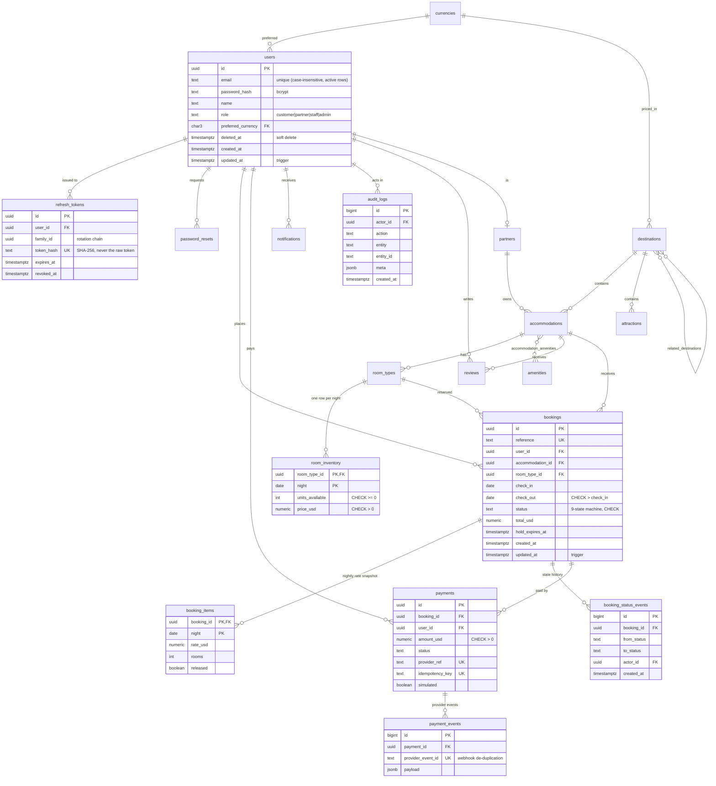

# Database design (PostgreSQL 16)

Normalized relational schema (3NF). Created by Flyway: `V1__schema.sql` (tables), `V2__integrity_and_audit.sql`
(triggers + extra indexes), `seed/V100__sample_data.sql` (demo data, dev only). A full `pg_dump` is in [`../sql/schema.sql`](../sql/schema.sql).

## ERD (core tables used by the REST API)

The remaining tables (`itineraries`, `itinerary_items`, `wishlist_items`, `travel_documents`, `document_chunks`, `ai_*`,
`search_history`, `exchange_rate_snapshots`) belong to the AI planner and personalisation features of the Express backend.
They are part of the shared schema but are not used by the Spring Boot API.

## How each requirement is met

| Requirement | Where |
|---|---|
| Primary keys | Every table: `uuid` (`gen_random_uuid()`), `bigserial` for append-only logs, composite keys for link/snapshot tables (`room_inventory`, `booking_items`, `accommodation_amenities`) |
| Foreign keys | 73 FK constraints; `ON DELETE CASCADE` only for owned children (tokens, images, items), plain `RESTRICT` for financial records (bookings, payments) |
| Constraints | 43 CHECKs (e.g. `check_out > check_in`, `units_available >= 0`, status/role enums, lat/lng ranges, `amount_usd > 0`), `UNIQUE` on slugs, references, provider refs, idempotency keys, token hashes |
| Indexes | 40 indexes: partial unique `users(lower(email)) WHERE deleted_at IS NULL`, `bookings(user_id, created_at DESC)`, `bookings(hold_expires_at) WHERE status='PENDING_CONFIRMATION'`, `room_inventory(night)`, GIN on `document_chunks.tsv`, and others in V1/V2 |
| Transactions | Booking creation locks inventory rows `FOR UPDATE`, decrements stock, inserts booking + items + event + notification + audit row in **one** transaction. Payment webhooks lock the payment and booking rows. Verified under load: 12 concurrent requests for 3 rooms produced exactly 3 bookings |
| Audit records | `audit_logs` (app-level: register, login-related changes, booking/payment events, admin actions) + `booking_status_events` (full state history) + DB trigger `users_audit_role` that logs any role change, even from raw SQL |
| Created/updated timestamps | `created_at` on every table; `updated_at` maintained by the `set_updated_at()` trigger on users, destinations, accommodations, attractions, bookings, payments |
| Appropriate relationships | 1-N (destination to accommodations), N-M (accommodations to amenities, destinations to related destinations), 1-N snapshot (booking to nightly rates), self-reference (`related_destinations`) |
| Soft deletion | `deleted_at` on users, destinations, accommodations, attractions, room_types. Account deletion anonymises PII but keeps bookings/payments for financial records |

## Money and inventory design notes

* All money is `numeric(12,2)` USD; display currency is converted at the edge (`currencies.per_usd`). No floats.
* `room_inventory` has one row **per room type per night**. A missing row means "not sellable". `InventoryService` keeps a rolling 180-day window filled.
* `booking_items` snapshots the nightly rate and `released` flag, so cancelling or expiring a booking returns exactly the stock that was taken, once.
