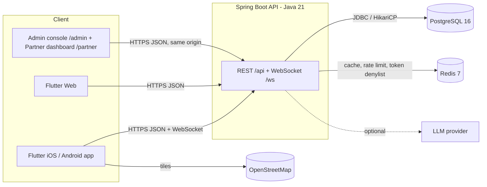
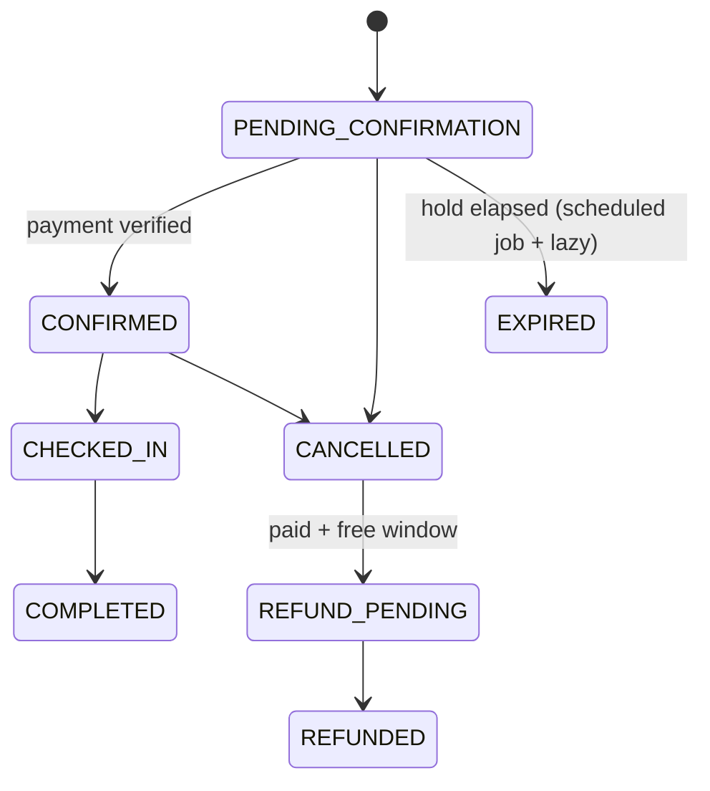

# Architecture



## Backend layout (`backend/src/main/java/com/wayfarer`)

Package-by-feature. Each feature owns its layers, and dependencies only point downwards (web -> service -> repository).

```
<feature>/web         REST controllers: HTTP mapping, validation, no business logic
<feature>/service     use cases, transactions, rules
<feature>/repository  all SQL (NamedParameterJdbcTemplate), returns rows
<feature>/dto         request/response records with Jakarta validation
```

| Feature | Responsibility |
|---|---|
| `auth`, `user` | register, login, refresh rotation, logout, password reset, profile, soft-delete account |
| `catalog` | destinations, accommodations and room search, attractions, home feed, gazetteer, route estimate |
| `booking`, `payment` | quote, create, cancel, hold expiry, state machine, inventory, simulated provider and signed webhook |
| `review`, `wishlist`, `notification` | reviews with stay check, saved items and search history, in-app notifications |
| `itinerary`, `ai` | trips and their editing, rules-based planner, retrieval-grounded assistant, optional LLM |
| `admin` | staff console APIs and destination content management |
| `partner` | partner accounts (admin side), properties and rooms (partner side), QR payment settings, read-only hotel listing for admins |
| `media` | image uploads (PNG/JPEG/WebP, stored in PostgreSQL, content sniffed) and public serving |
| `static/{admin,partner,dashboard}` | the two web dashboards (ES modules, no build step) served by Spring at `/admin` and `/partner` |
| `security`, `config`, `common`, `audit`, `ws` | JWT filter, RBAC rules, Redis rate limit and denylist, errors, paging, audit trail, WebSocket |

Key decisions
- **SQL stays explicit.** Booking locking (`FOR UPDATE`), availability search and reporting queries are written as SQL in repositories rather than hidden behind an ORM.
- **Rows as maps for read models.** Catalogue-style responses pass database rows through (snake_case), which is the API contract the mobile app was built against. Request bodies and the planner/assistant results are typed records.
- **Flyway owns the schema** (`db/migration`); `db/seed` holds demo data and is not loaded in production.
- **Redis is an optimisation, not a dependency.** If it is down the API still serves (no cache, no rate limit, no logout denylist) and logs a warning.
- **Live events after commit.** Status changes publish Spring events handled by `@TransactionalEventListener(AFTER_COMMIT)` and pushed over `/ws`.

## Client
Flutter, Riverpod providers (cached async data keyed by query objects), go_router with auth redirects, Dio client with single-flight refresh on 401, tokens in secure storage, one authenticated WebSocket while signed in.

## AI
`LlmClient` is a provider abstraction (Anthropic Messages API). `PlannerService` always retrieves from the database; `DayScheduler` is deterministic and explainable; the model, when configured, may only rewrite summary text. `AssistantService` answers from the destination record and approved guides and refuses to guess.

## Booking state machine

`DRAFT` exists in the enum but the API creates bookings directly in `PENDING_CONFIRMATION`.

## Payment state machine
`PENDING -> SUCCESS | FAILED | CANCELLED`, `SUCCESS -> REFUNDED`.
